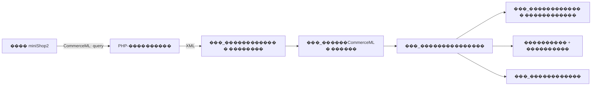

# 1�:����������� 3.0 - MODX/miniShop2 � ���������� �� CommerceML

**���� ��� ���������:** �������������� ����� �������� ����� ��������-���������
(MODX/miniShop2) � 1�:����������� 3.0.

**������:** ������-���������������� ������, ��������� ���������������.
���������� �������������� � �������� ��������� � �� ����������� �� �������� ����.
��� ���������������� �� �������� MIT.

## ������

������������� ���������� ������ � ����� � 1�. ��� ���������� �������
���������� � ��������� � ��������� �������� ����������� ������� � �����
� ���������� �� ������. ���������� ������������������: ������ ������ ������
�� ������������� ���� �����.

## �����������

���� (PHP) > CommerceML 2.0 > 1� (�������� > ������ > �������� > ����������).

���������� ��������� ��� **���������� ������������** � ������� �����������
����������� 3.0 �� ��������������, ���������� ��������� �� ������ �����.
������������ � �� ������� 1� ����� ������� �������� `���_������������`.

������ �������� ����������� � � [docs/architecture.md](docs/architecture.md).



���� ��������� �� ���������������:

- `���_������������` � **���������**: HTTP, ������, ������� ���������,
  �������� ������;
- `���_������CommerceML` � **������**: XML > ��������� ������;
- `���_���������������` � **��������**: �����������, ���������, ����������.

������ ���������� ��� ������� �� ����������� ������ �������� � � ��������.

## ������� ����� (PHP)

- ���������� `1c_exchange.php`: ������� `checkauth`, `init`, `query`, `success`.
- ������������: Basic Auth (������ � ���), �������������� HTTPS, rate?limit
  �� IP, ������ ������.
- ��������� ������: ������ � ������� ���������� �������� ��� ������ ������ �
  ���������, ������ ��� ������������ ����������� �� ������� 1�.

## ������� 1�

- `���_������������` � ���� ���������, HTTPS-���������� � Basic Auth, ������
  � ��������� ��������, �������� ������ ��������� �������
  (`�����������������` � ���������������), ���������� ��������� `success`.
- `���_������CommerceML` � ��������� ������ XML ����� `������XML`,
  ���������-�������, ����� ������ �����, ������������ ��������.
- `���_���������������` � ������������ ������������, ���������, ������������
  �� ��������; �������� � ���������� ����������.
- `���_������������` � ������� �������� �� > ����� > �����������: ���������
  ������ ������������.
- `���_������������` � ����������� ������: �����, ������, ������ � ���������.
- ������ ������ � ��������� ��� ������� ������� � ��������� �����������.
- `���_���������������` � ���������� ����������: �����, �����, ������
  ����������, �����������, �����; �������� ������ ������������ �������������.

## �������� ��������

- **����� �������� ������ ���� ���.** ���� ������ ���� �������� ����� ������
  ������. �������: ��������� ������ ������� � ������� ���������� +
  ������������ �� ������� 1�.
- **������ ���������� ������ ���� �����.** �������: ������������� ���������
  ������ � ��������������� ������� � ����� ������������ �� ��������� �������.
- **������� XML � ��������� CommerceML.** �������: ���������� ������ ��������,
  ����� ������ �����, ������� ���������� ������� � ������� � ������.
- **���� �������������� �����������.** CommerceML ����� ����� � ������
  (`199.00`), � `�����()` � ������� ������ 1� ��� �������. �������:
  ���������������� �������������� � ������� ����������� � �������.

## ���������

������ �������������� ����: ����� �� ����� > ������ ���������� > ����� >
���������� ���������� � 1� � ���������� �� �����. ������ �������� ��
���������.

## ������ �����������

```text
+-- src/extension/        < �������� ���������� �� ������������� (XML)
+-- php/1c_exchange.php   < ��������� ����� ��������� (MODX/miniShop2)
+-- docs/architecture.md  < ��������� ����������� ����������
+-- screenshots/          < ������ ������, ������, ���������� ��������
L-- LICENSE               < MIT
```

## ������������

1. ������� ������������ ������������ ����������� 3.0� (1� 8.3).
2. ������������ > ���������� ������������ > �������� > ���������� �� ������
   > ������� `src/extension/`.
3. ��������� ���������.
4. ������� ������� ����������� `���_���������������` (�����, �����, ������,
   �����������, �����) � ��������� ������ ������ � �� ������������
   � ��������� ��������.
5. ���������� `php/1c_exchange.php` �� �����, ������� �������� ������� ������,
   ��������� � ����������� HTTPS.
6. ��������� ����� � ������ ������ ���� �� ����������.

## ����������

1� 8.3 (�� 3.0) � ���������� ������������ � ���������� ���� 1� � ��������
�������� � PHP � MODX Revolution (xPDO) � miniShop2 � CommerceML 2.0 � MySQL

## ��� ��� ���������� ������������

- ��������� ��������� CommerceML � ��� ���������� � ���� � ��� �������
  (������ � ������) �������� ��������������.
- ���������� �� ����: ��������� / ������ / �������� � ������ ���������
  � �������� ��������.
- ������������������ �� �����: �������� ������ �������, ����������,
  ��������������� ����� ������� ������.
- ������ � ������������: ���������� ��� ������ ������������ � ���������.

## ��������

������ ���������������� �� �������� MIT � ��� ����� �������� ������������,
������� � ������������ ��� ���� ������. �������� ��������� ��������������,
�� �� �����������.
