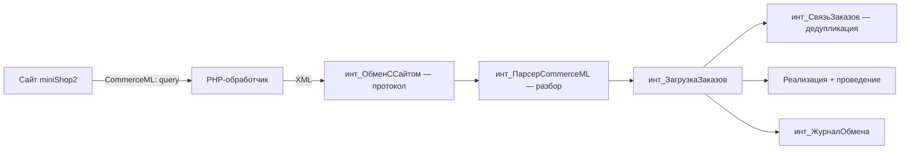

# 1С:Бухгалтерия 3.0 ↔ MODX/miniShop2 — интеграция по CommerceML

**Кейс для портфолио:** автоматический обмен заказами между интернет‑магазином
(MODX/miniShop2) и 1С:Бухгалтерия 3.0.

**Статус:** учебно‑демонстрационный проект, полностью работоспособный.
Разработан самостоятельно в качестве портфолио — от архитектуры до рабочего кода.
Код распространяется по лицензии MIT.

## Задача

Автоматически переносить заказы с сайта в 1С. При достижении статуса
«отправлен» — создавать и проводить документ «Реализация товаров и услуг»
с движениями по складу. Обеспечить отказоустойчивость: ошибка одного заказа
не останавливает весь обмен.

## Архитектура

Сайт (PHP) → CommerceML 2.0 → 1С (протокол → парсер → загрузка → реализация).

Интеграция оформлена как **расширение конфигурации** — типовая Бухгалтерия
предприятия 3.0 не модифицируется, обновления платформы не ломают обмен.
Дедупликация — на стороне 1С через регистр сведений `инт_СвязьЗаказов`.

Полное описание архитектуры — в [docs/architecture.md](docs/architecture.md).



Слои разделены по ответственности:

- `инт_ОбменССайтом` — **транспорт**: HTTP, сессии, команды протокола,
  хранение пароля;
- `инт_ПарсерCommerceML` — **разбор**: XML → структуры данных;
- `инт_ЗагрузкаЗаказов` — **загрузка**: справочники, документы, проведение.

Замена транспорта или формата не затрагивает логику загрузки — и наоборот.

## Сторона сайта (PHP)

- Обработчик `1c_exchange.php`: команды `checkauth`, `init`, `query`, `success`.
- Безопасность: Basic Auth (пароль — хэш), принудительный HTTPS, rate‑limit
  по IP, сессии обмена.
- Повторная отдача: заказы в статусе «отправлен» отдаются при каждом обмене —
  безопасно, потому что дедупликация выполняется на стороне 1С.

## Сторона 1С

- `инт_ОбменССайтом` — цикл протокола, HTTPS‑соединение и Basic Auth, пароль
  в хранилище значения, изоляция ошибок отдельных заказов
  (`Попытка…Исключение` с журналированием), корректная семантика `success`.
- `инт_ПарсерCommerceML` — потоковый разбор XML через `ЧтениеXML`,
  состояние‑автомат, белый список полей, нормализация значений.
- `инт_ЗагрузкаЗаказов` — автосоздание контрагентов, договоров, номенклатуры
  по артикулу; создание и проведение реализаций.
- `инт_СвязьЗаказов` — регистр «внешний Ид → заказ → реализация»: повторная
  отдача идемпотентна.
- `инт_ЖурналОбмена` — собственный журнал: факты, отказы, ошибки с причинами.
- Панель обмена — обработка для ручного запуска и просмотра результатов.
- `инт_НастройкиОбмена` — справочник параметров: адрес, логин, статус
  «отправлен», организация, склад; активная запись используется автоматически.

## Решённые проблемы

- **Заказ приходил только один раз.** Сайт снимал флаг выгрузки после первой
  отдачи. Решение: повторная отдача заказов в статусе «отправлен» +
  дедупликация на стороне 1С.
- **Ошибка проведения ломала весь обмен.** Решение: изолированная обработка
  ошибок с журналированием причины — обмен продолжается по остальным заказам.
- **Парсинг XML и валидация CommerceML.** Решение: выделенный модуль парсинга,
  белый список полей, пропуск проблемных заказов с записью в журнал.
- **Цены распознавались некорректно.** CommerceML отдаёт числа с точкой
  (`199.00`), а `Число()` в русской локали 1С ждёт запятую. Решение:
  централизованное преобразование с заменой разделителя в парсере.

## Результат

Полный автоматический цикл: заказ на сайте → статус «отправлен» → обмен →
проведённая реализация в 1С с движениями по учёту. Ручные операции не
требуются.

## Состав репозитория

```text
├── src/extension/        ← выгрузка расширения из Конфигуратора (XML)
├── php/1c_exchange.php   ← серверная часть протокола (MODX/miniShop2)
├── docs/architecture.md  ← подробная архитектура интеграции
├── screenshots/          ← панель обмена, журнал, проведённый документ
└── LICENSE               ← MIT
```

## Развёртывание

1. Открыть конфигурацию «Бухгалтерия предприятия 3.0» (1С 8.3).
2. Конфигурация → Расширения конфигурации → добавить → «Загрузить из файлов»
   → каталог `src/extension/`.
3. Применить изменения.
4. Создать элемент справочника `инт_НастройкиОбмена` (адрес, логин, статус,
   организация, склад) и сохранить пароль обмена — он записывается
   в хранилище значения.
5. Разместить `php/1c_exchange.php` на сайте, завести обменную учётную запись,
   убедиться в доступности HTTPS.
6. Запустить обмен с панели обмена либо по расписанию.

## Технологии

1С 8.3 (БП 3.0) · расширения конфигурации · встроенный язык 1С · регистры
сведений · PHP · MODX Revolution (xPDO) · miniShop2 · CommerceML 2.0 · MySQL

## Что это показывает работодателю

- Понимание протокола CommerceML и его реализации с нуля — обе стороны
  (сервер и клиент) написаны самостоятельно.
- Разделение на слои: транспорт / разбор / загрузка — каждый тестируем
  и заменяем отдельно.
- Отказоустойчивость по слоям: изоляция ошибок заказов, транзакции,
  идемпотентность через регистр связей.
- Работа с расширениями: интеграция без снятия конфигурации с поддержки.

## Лицензия

Проект распространяется по лицензии MIT — код можно свободно использовать,
изучать и адаптировать под свои задачи. Указание авторства приветствуется,
но не обязательно.
