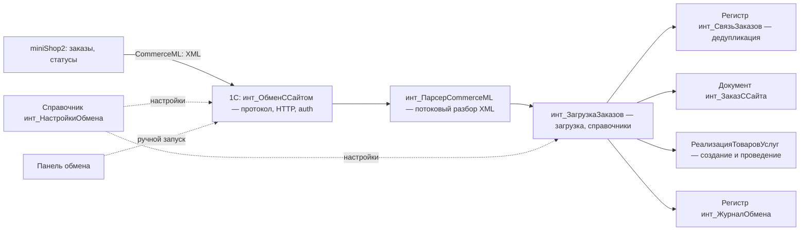

# Архитектура интеграции 1С:Бухгалтерия 3.0 ↔ MODX/miniShop2

## Общее описание

Интеграция обеспечивает автоматический обмен заказами между интернет‑магазином
на MODX + miniShop2 и учётной системой 1С:Бухгалтерия 3.0.

Обмен построен на протоколе **CommerceML 2.0** — стандартном протоколе обмена
«1С — сайт». Используется его клиентская схема: 1С выступает HTTP‑клиентом и
по расписанию опрашивает обработчик на сайте.

Направление обмена — **одностороннее**: заказы идут с сайта в 1С. Обратная
синхронизация статусов (из 1С на сайт) в текущей версии не реализована и
выделена в возможное развитие.

**Статус проекта:** учебно‑демонстрационный, полностью работоспособный.
Код распространяется по лицензии MIT.

## Состав расширения

Интеграция оформлена как **расширение конфигурации** — не требует снятия
конфигурации Бухгалтерии предприятия 3.0 с поддержки и разворачивается
загрузкой из файлов.

| Тип объекта | Имя | Назначение |
|---|---|---|
| Общий модуль | `инт_ОбменССайтом` | Клиентская часть протокола CommerceML, HTTP, auth |
| Общий модуль | `инт_ПарсерCommerceML` | Потоковый разбор XML CommerceML |
| Общий модуль | `инт_ЗагрузкаЗаказов` | Загрузка заказов, справочники, реализация |
| Справочник | `инт_НастройкиОбмена` | Параметры обмена (адрес, логин, статус, организация, склад) |
| Документ | `инт_ЗаказССайта` | Непроводимый документ‑приёмник заказа с сайта |
| Регистр сведений | `инт_СвязьЗаказов` | Дедупликация: внешний Ид → заказ → реализация |
| Регистр сведений | `инт_ЖурналОбмена` | Собственный журнал обмена |
| Обработка | Панель обмена | Ручной запуск обмена и просмотр результатов |

Исходники выгружены в XML и хранятся в `src/extension/` — объекты можно
читать прямо на GitHub, а расширение развернуть по инструкции ниже.

## Развёртывание

1. Открыть конфигурацию «Бухгалтерия предприятия 3.0» (1С 8.3).
2. Конфигурация → Расширения конфигурации → добавить.
3. «Загрузить из файлов» → указать каталог `src/extension/`.
4. Применить изменения.
5. Создать элемент справочника `инт_НастройкиОбмена` и сохранить пароль
   обмена (записывается в хранилище значения через процедуру
   `СохранитьПароль`).
6. На стороне сайта разместить `php/1c_exchange.php`, завести обменную
   учётную запись, убедиться в доступности HTTPS.
7. Запустить обмен с панели обмена либо по расписанию.

## Компоненты

Слои разделены по ответственности:

- `инт_ОбменССайтом` — **транспорт**: знает всё про HTTP, сессии, команды
  протокола и хранение пароля, но ничего не знает про документы 1С;
- `инт_ПарсерCommerceML` — **разбор**: превращает XML в структуры данных,
  знает формат CommerceML, но ничего не знает про транспорт и документы;
- `инт_ЗагрузкаЗаказов` — **загрузка**: работает только со структурами
  данных, ничего не знает про HTTP и XML.

Панель обмена — тонкий клиент над `инт_ОбменССайтом`: не содержит логики
обмена, только вызывает экспортную функцию и показывает отчёт.

Такое разделение позволяет заменить транспорт или формат обмена, не трогая
логику загрузки, — и наоборот.

## Поток данных при одном обмене

1. 1С вызывает `checkauth` — получает идентификатор сессии (cookie).
2. 1С вызывает `init` — узнаёт параметры обмена (лимит размера, `zip=no`).
3. 1С вызывает `query` — получает XML с заказами.
4. `инт_ПарсерCommerceML` разбирает XML и формирует структуры данных.
   Ошибка разбора фиксируется в журнале, обмен завершается — без валидного
   XML продолжать бессмысленно.
5. `инт_ЗагрузкаЗаказов` обрабатывает каждый заказ: проверяет связь в
   регистре, создаёт (или пропускает) документ заказа; при статусе
   «отправлен» создаёт и проводит реализацию. Сбой одного заказа
   изолируется, остальные обрабатываются штатно.
6. Результаты каждой операции фиксируются в `инт_ЖурналОбмена`.
7. 1С вызывает `success` — обмен завершён.

## Сторона сайта: обработчик `1c_exchange.php`

Самостоятельная реализация серверной части протокола CommerceML (без
готовых модулей синхронизации). Обрабатывает четыре команды:

| Команда | Назначение |
|---|---|
| `checkauth` | Аутентификация, выдача идентификатора сессии |
| `init` | Параметры обмена: лимит размера файла, поддержка zip |
| `query` | Выгрузка заказов в формате CommerceML (XML) |
| `success` | Подтверждение успешной загрузки |

Ключевые решения:

- **Повторная отдача заказов.** В `query` включаются: (а) заказы, ещё не
  выгруженные в 1С; (б) заказы в статусе «отправлен». Повторная отдача
  безопасна: дедупликация выполняется на стороне 1С, которая сама решает,
  нужно ли создавать документ.
- **Флаг выгрузки** хранится в `properties` заказа miniShop2
  (`onec_exported`).
- **Лимит отдачи** — до 200 заказов за один запрос: ответ не превышает
  допустимый размер и укладывается в таймауты.

### Безопасность на стороне сайта

- **Basic Auth**: отдельная учётная запись только для обмена; пароль
  хранится хэшем.
- **HTTPS‑only**: обмен отвергает запросы по HTTP.
- **Rate‑limit по IP**: защита от перебора и «шторма» запросов.
- **Сессии обмена**: идентификатор, выданный в `checkauth`, обязателен во
  всех последующих командах.
- Обменный логин не совпадает с учётками администраторов сайта и не даёт им
  прав в админке.

## Сторона 1С

### Модуль протокола `инт_ОбменССайтом`

Реализует клиентскую часть протокола:

- цикл команд `checkauth → init → query → success`;
- **хранение пароля в хранилище значения**: реквизит настроек не содержит
  пароля в открытом виде; получение и запись — через экспортные процедуры
  `СохранитьПароль` / `ПолучитьПароль` с диагностикой при отсутствии пароля;
- сводная структура настроек (адрес, путь скрипта, логин, пароль, статус
  «отправлен», организация, склад) передаётся и в HTTP‑слой, и в загрузчик —
  исключены повторные запросы к справочнику настроек из глубины кода;
- **Basic Auth**: заголовок формируется из логина и пароля настроек;
- **защищённое соединение** (`ЗащищенноеСоединениеOpenSSL`) при каждом
  запросе — обмен не работает по открытым каналам; таймаут 30 секунд;
- **обработка HTTP‑ошибок**: при коде ответа ≥ 400 выбрасывается исключение
  с кодом состояния и фрагментом тела ответа;
- **проверка совместимости в `init`**: обмен требует `zip=no`; если сайт
  требует сжатие, цикл прерывается с понятным текстом ошибки;
- **изоляция ошибок заказов**: обработка каждого заказа выполняется в блоке
  `Попытка…Исключение`; сбой одного документа фиксируется в журнале, обмен
  продолжается по остальным. Итоговый отчёт содержит число обработанных
  заказов и число ошибок.

Семантика завершения обмена: если ошибка возникла **до** `success` (обрыв
связи, некорректный XML), команда `success` не отправляется — сайт оставит
заказы в очереди выгрузки, и они будут переданы снова при следующем обмене.
Повторная отдача безопасна благодаря дедупликации на стороне 1С.

Осознанное исключение: если отдельные заказы обработались с ошибками, но
обмен в целом прошёл, `success` отправляется — иначе проблемный заказ
залип бы в бесконечном цикле повторной отдачи. Такие заказы фиксируются
в журнале и разбираются вручную.

### Модуль парсинга `инт_ПарсерCommerceML`

Отдельный слой разбора входящего XML. Экспортируемая функция
`ПрочитатьЗаказы(XMLСтрока)` возвращает массив структур — единственный
формат, который принимает модуль загрузки.

Технические решения:

- **Потоковое чтение через `ЧтениеXML`.** Документ разбирается
  последовательно, без построения DOM‑дерева — выгрузка любого размера
  обрабатывается с постоянным расходом памяти.
- **Состояние‑автомат.** Позиция внутри документа отслеживается тремя
  переменными контекста: текущий заказ (`ТекущийЗаказ`), текущая товарная
  позиция (`ТекущийТовар`), признак «внутри блока Контрагент»
  (`ВКонтрагенте`). Текстовые узлы попадают в нужную структуру в зависимости
  от контекста.
- **Белый список полей через `Свойство()`.** В структуры включены только
  заранее объявленные поля: Ид, Номер, Дата, Время, Валюта, СтатусЗаказа,
  реквизиты контрагента (Ид, Наименование, Email, Телефон), реквизиты
  позиций (Ид, Артикул, Наименование, БазоваяЕдиница, ЦенаЗаЕдиницу,
  Количество, Сумма). Посторонние элементы CommerceML (`ЗначенияРеквизитов`,
  `Налог` и прочие) игнорируются без потери работоспособности.
- **Нормализация значений**: обрезка пробелов у всех текстовых узлов;
  числовые поля (цена, количество, сумма) приводятся к типу Число.
- **Обработка разделителя дробной части.** CommerceML отдаёт числа с точкой
  (`199.00`), а `Число()` в русской локали 1С ожидает запятую. Разница
  устраняется централизованно в функции `ВЧисло()` заменой разделителя.
  Без этого цены и суммы распознавались бы некорректно либо вызывали ошибку
  преобразования.

Результат — коллекция структур вида «ДанныеЗаказа»: идентификатор, номер,
дата и время, валюта, статус, контрагент (отдельная структура) и массив
товарных позиций. Посторонние и некорректные узлы не прерывают разбор
остальных документов.

### Модуль загрузки `инт_ЗагрузкаЗаказов`

Отвечает за перенос данных в учётную систему:

- **Контрагент** — ищется по наименованию, при отсутствии создаётся
  (физическое лицо);
- **Номенклатура** — ищется по артикулу, при отсутствии создаётся;
- **Договор** — ищется договор вида «С покупателем», при отсутствии
  создаётся;
- **Документ `инт_ЗаказССайта`** — непроводимый документ‑приёмник заказа;
- **РеализацияТоваровУслуг** — создаётся и проводится автоматически
  (условие см. ниже).

Все справочники создаются с поиском перед созданием: повторный обмен не
порождает дублей.

Порядок работы с реализацией: документ сначала записывается
(`РежимЗаписиДокумента.Запись`), затем проводится
(`РежимЗаписиДокумента.Проведение`) в блоке `Попытка…Исключение`.
При ошибке проведения документ остаётся записанным непроведённым, причина
попадает в журнал — документ дооформляется вручную, остальные заказы
обрабатываются штатно.

### Регистр сведений `инт_СвязьЗаказов`

Центральный элемент дедупликации. Хранит тройку:

| Поле | Содержимое |
|---|---|
| `ВнешнийИд` | Идентификатор заказа на сайте (GUID из CommerceML) |
| `Документ1С` | Ссылка на созданный документ заказа |
| `Реализация` | Ссылка на созданную реализацию (заполняется позже) |

Логика: если запись с данным `ВнешнийИд` уже есть — документ не создаётся
повторно; если поле `Реализация` заполнено — реализация не создаётся
повторно. Благодаря этому повторная отдача заказа со стороны сайта
идемпотентна.

### Регистр сведений `инт_ЖурналОбмена`

Собственный журнал обмена: период, идентификатор записи, событие, текст,
признак успеха. В журнал попадают:

- факты создания заказов и реализаций;
- итог обмена: число обработанных заказов и число ошибок;
- причины отказа от создания (статус не совпал с настройкой);
- ошибки проведения — с текстом `ОписаниеОшибки()`;
- ошибки разбора XML — с описанием ошибки;
- ошибки связи (не удалось создать документ или запись регистра).

### Панель обмена

Обработка с управляемой формой — точка ручного управления обменом:

- запуск цикла обмена одной кнопкой (вызов `инт_ОбменССайтом.ВыполнитьЦиклОбмена`);
- выбор записи настроек либо работа с активной по умолчанию;
- отображение итогового отчёта (число обработанных заказов, число ошибок);
- журнал последних обменов из регистра `инт_ЖурналОбмена`.

Логики в форме нет — она демонстрирует разделение интерфейса и бизнес‑логики.

### Справочник `инт_НастройкиОбмена`

Параметры обмена вынесены из кода:

- адрес сервера и путь скрипта обработчика;
- логин обмена (пароль — в хранилище значения);
- текст статуса «отправлен» (как его отдаёт сайт);
- организация и склад для реализаций;
- признак «Активен» — активная запись используется автоматически, если
  настройки не переданы явно.

## Управление созданием реализации

Реализация создаётся только тогда, когда статус заказа на сайте совпадает
со значением «статус отправлен» из настроек обмена. Сравнение выполняется
в нижнем регистре после обрезки пробелов — сайт и 1С могут писать статус
по‑разному.

Сценарии:

| Статус на сайте | Реализация есть | Действие 1С |
|---|---|---|
| «новый» | нет | заказ загружен, реализация отложена |
| «отправлен» | нет | создана и проведена реализация |
| «отправлен» | да | ничего (защита от дублей) |
| любой, кроме «отправлен» | нет | заказ загружен, в журнал — диагностика |

## Отказоустойчивость

Принцип: **ошибка на одном заказе не останавливает обмен.**

| Уровень | Что изолируется | Поведение |
|---|---|---|
| Транспорт (`инт_ОбменССайтом`) | HTTP‑ошибки, таймауты | Исключение с кодом и фрагментом ответа; обмен завершается |
| Разбор (`инт_ПарсерCommerceML`) | Ошибки формата XML | Обмен завершается с записью в журнал; ранее загруженные заказы не теряются |
| Загрузка (`инт_ЗагрузкаЗаказов`) | Сбой конкретного заказа | Транзакция откатывается, ошибка — в журнал, обработка продолжается |
| Проведение реализации | Ошибка проведения | Документ остаётся записанным непроведённым; причина — в журнале |

Дополнительно:

- справочники создаются с поиском перед созданием — повторный обмен не
  дублирует контрагентов, номенклатуру и договоры;
- регистр связей делает повторную отдачу заказов безопасной;
- расширение не модифицирует типовую конфигурацию — обновления Бухгалтерии
  не ломают интеграцию.

## Ограничения и развитие

Реализовано:

- односторонний обмен «сайт → 1С»;
- собственная реализация серверной и клиентской части протокола CommerceML;
- выделенный слой парсинга с потоковым чтением, валидацией и нормализацией;
- автоматическое создание и проведение реализаций;
- дедупликация через регистр связей;
- собственный журнал обмена и панель управления;
- хранение пароля в хранилище значения;
- упаковка в расширение — установка без модификации типовой конфигурации.

Возможное развитие:

- обратная синхронизация статусов «1С → сайт» (например, отметка «отгружено»);
- выгрузка остатков и цен из 1С на сайт;
- обмен счётами и оплатами (входящие платежи по заказам);
- пакетная обработка крупных партий заказов через zip‑архивы;
- повторный запуск проведения для заказов с ошибками по данным журнала.

## Технологии

- 1С 8.3, расширения конфигурации, встроенный язык, регистры сведений
- Бухгалтерия предприятия 3.0
- PHP, MODX Revolution API (xPDO), miniShop2
- CommerceML 2.0, XML, HTTP, Basic Auth
- MySQL (сторона сайта)
